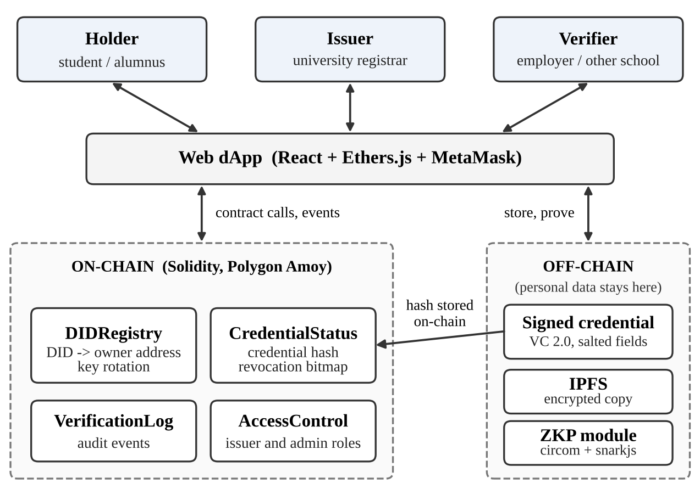

# Decentralized Degree Verification

CSE 540: Engineering Blockchain Applications, Fall B 2026, Project Group 11

## What this project is

When someone applies for a job or another degree, the employer has to check that their degree is real. Today that usually means emailing the registrar or trusting an uploaded PDF, which is slow and easy to fake. Students also end up sharing their whole transcript just to prove one thing.

We are building a dApp where:

- **Students (holders)** own their credentials and choose what to share.
- **Universities (issuers)** record a hash of each credential on the blockchain and can revoke it later.
- **Employers or other schools (verifiers)** can check a credential at any time without contacting the university.

No personal data goes on-chain. The blockchain only stores hashes, roles and a revocation bit for each credential. The actual credential remains off-chain; encrypted IPFS backup is planned for the final milestone.



## Smart contracts

| Contract | What it does |
|---|---|
| `IssuerAccessControl` | The admin approves or removes universities that can issue credentials (built on OpenZeppelin `AccessControl`). |
| `DIDRegistry` | Students register a DID with a link to their DID document (keys and service endpoints, stored on IPFS) and its hash. They can update it, rotate keys or deactivate the DID. |
| `CredentialStatus` | Universities anchor credential hashes and revoke them. Revocation is one bit in a per-issuer bitmap, so it stays cheap. |
| `VerificationLog` | Audit trail of issue, revoke and verify events. Only `CredentialStatus` can write to it. |

The interfaces for each contract are in `contracts/interfaces/`. They show every function signature and event, so the frontend and off-chain parts can be built against them while the contracts are still changing.

### How a credential moves through the system

1. The student uploads their DID document to IPFS and calls `registerDID(hash, "ipfs://...")` on `DIDRegistry`.
2. The admin calls `addIssuer()` to approve the university.
3. The university signs the credential off-chain, then calls `issueCredential(hash, student)`.
4. An employer gets the credential from the student, hashes it, and calls `isValid(hash)`, or `verifyAndLog(hash)` to also leave a record.
5. If needed, the university calls `revokeCredential(hash)` and the credential stops being valid.

## Repository layout

```
contracts/
  interfaces/       contract interfaces (signatures and events)
  access/           IssuerAccessControl
  DIDRegistry.sol
  CredentialStatus.sol
  VerificationLog.sol
scripts/deploy.js   deploys all four contracts and links them
scripts/demo.js     runs the complete stakeholder workflow
test/               integration and contract tests
frontend/           React, Ethers.js and MetaMask demo
offchain/           credential signing, selective disclosure, IPFS (planned)
docs/               architecture diagram
```

## Setup

You need **Node.js 18 or newer** and **npm**. MetaMask is needed for the browser workflow but not for the terminal demo or tests.

```bash
git clone https://github.com/amoghranavade/GR-11-Decentralized-Degree-Verification-Blockchain.git
cd GR-11-Decentralized-Degree-Verification-Blockchain
npm install
npm run frontend:install
```

Main dependencies:

- Hardhat (compile, test, deploy)
- OpenZeppelin Contracts (`AccessControl`)
- dotenv (reads the RPC URL and private key from `.env`)
- React, Ethers.js and Vite (frontend)

## Compile and test

```bash
npx hardhat compile
npx hardhat test
```

## Interim stakeholder demo

Run the deterministic terminal demo without MetaMask or a separate blockchain process:

```bash
npm run demo
```

It deploys the contracts on an ephemeral Hardhat network and demonstrates:

1. The administrator approves a university.
2. A student registers an active DID.
3. The university issues a credential.
4. An employer verifies the credential as valid.
5. Unauthorized issuance is rejected.
6. The university revokes the credential.
7. The employer verifies the credential as invalid.

The script exits with an error if any expected result or verification event is missing.

## Deploy

**Local Hardhat network and frontend:**

```bash
npm run node
```

In a second terminal:

```bash
npm run deploy:local
```

The deployment writes contract addresses and ABIs to the frontend configuration. In a third terminal:

```bash
npm run frontend
```

Connect MetaMask to `http://127.0.0.1:8545` with chain ID `31337`. Use only the local test accounts printed by Hardhat. Switch between administrator, university, student and employer accounts as the workflow moves between stakeholders.

**Polygon Amoy testnet:**

Amoy does not require a separate Polygon account. Use dedicated test-only MetaMask wallets and never reuse wallets that hold real assets. One funded wallet is enough to deploy. For the complete stakeholder workflow, the administrator, university and student wallets need test POL, and the employer wallet also needs test POL when calling `verifyAndLog()`.

1. Copy `.env.example` to `.env`.
2. Set `AMOY_RPC_URL` and the private key of the dedicated test wallet.
3. Add Polygon Amoy to MetaMask using chain ID `80002` and currency `POL`.
4. Get test POL from the [Polygon faucet](https://faucet.polygon.technology/).
5. Run:

```bash
npm run deploy:amoy
```

The script prints each contract address and updates the frontend deployment configuration. A Polygonscan account is not needed for deployment. Never commit `.env` or a private key.

## Current status

The smart contracts, interfaces, local deployment, stakeholder demo and initial React/MetaMask integration are implemented. The interim workflow covers issuer approval, DID registration, credential issuance, verification, revocation and audit events.

Work still in progress includes off-chain W3C credential signing, selective disclosure, encrypted IPFS storage, the ZKP demo, Amoy deployment evidence, gas measurements and the final scalability and privacy analysis.

## Team

| Member | Area |
|---|---|
| Amatya Katyayan | DIDRegistry and access control |
| Amogh Prasad Ranavade | Frontend and integration |
| Harsh Patel | CredentialStatus and VerificationLog |
| Isha Nimesh Shah | Off-chain layer (signing, selective disclosure, IPFS) |
| Siddhi Pramod Chaudhari | ZKP demo, deployment and gas reporting |
