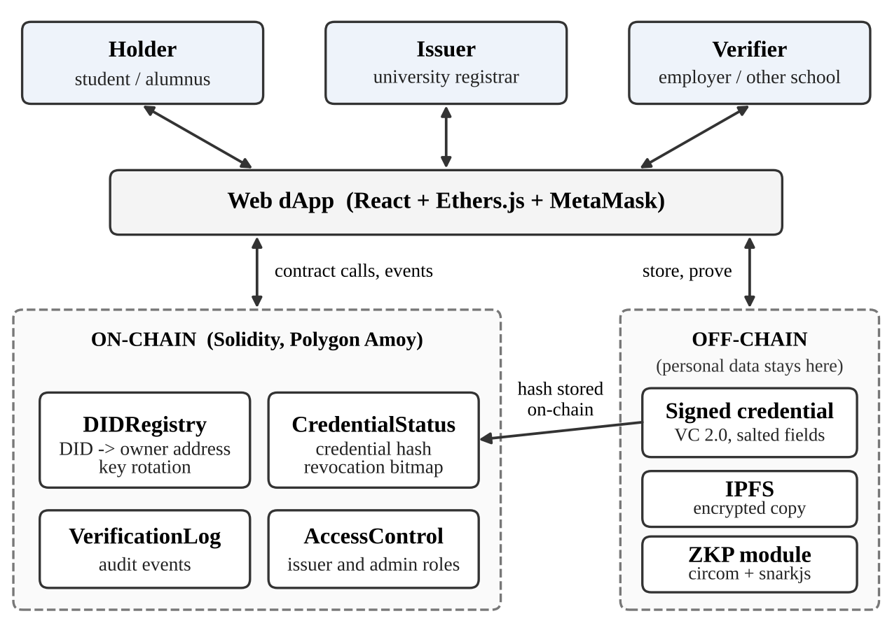

# Decentralized Degree Verification

CSE 540: Engineering Blockchain Applications, Fall B 2026, Project Group 11

## What this project is

When someone applies for a job or another degree, the employer has to check that their degree is real. Today that usually means emailing the registrar or trusting an uploaded PDF, which is slow and easy to fake. Students also end up sharing their whole transcript just to prove one thing.

We are building a dApp where:

- **Students (holders)** own their credentials and choose what to share.
- **Universities (issuers)** record a hash of each credential on the blockchain and can revoke it later.
- **Employers or other schools (verifiers)** can check a credential at any time without contacting the university.

No personal data goes on-chain. The blockchain only stores hashes, roles and a revocation bit for each credential. The actual credential stays with the student, with an encrypted backup on IPFS.



## Smart contracts

| Contract | What it does |
|---|---|
| `IssuerAccessControl` | The admin approves or removes universities that can issue credentials (built on OpenZeppelin `AccessControl`). |
| `DIDRegistry` | Students register a DID with a link to their DID document (keys and service endpoints, stored on IPFS) and its hash. They can update it, rotate keys or deactivate the DID. |
| `CredentialStatus` | Universities anchor credential hashes and revoke them. Revocation is one bit in a per-issuer bitmap, so it stays cheap. |
| `VerificationLog` | Audit trail of issue, revoke and verify events. Only `CredentialStatus` can write to it. |

The interfaces for each contract are in `contracts/interfaces/`. They show every function signature and event, so the frontend and off-chain parts can be built against them while the contracts are still changing.

### How a credential moves through the system

1. The student uploads their DID document to IPFS and calls `registerDID(hash, "ipfs://...")` on `DIDRegistry`.
2. The admin calls `addIssuer()` to approve the university.
3. The university signs the credential off-chain, then calls `issueCredential(hash, student)`.
4. An employer gets the credential from the student, hashes it, and calls `isValid(hash)`, or `verifyAndLog(hash)` to also leave a record.
5. If needed, the university calls `revokeCredential(hash)` and the credential stops being valid.

## Repository layout

```
contracts/
  interfaces/       contract interfaces (signatures and events)
  access/           IssuerAccessControl
  DIDRegistry.sol
  CredentialStatus.sol
  VerificationLog.sol
scripts/deploy.js   deploys all four contracts and links them
test/               Hardhat tests
frontend/           React app (planned)
offchain/           credential signing, selective disclosure, IPFS (planned)
zkp/                zero-knowledge proof demo (planned)
docs/               architecture diagram
```

## Setup

You need **Node.js 18 or newer** and **npm**. MetaMask is only needed for the testnet deployment.

```bash
git clone https://github.com/amoghranavade/GR-11-Decentralized-Degree-Verification-Blockchain.git
cd GR-11-Decentralized-Degree-Verification-Blockchain
npm install
```

Main dependencies:

- Hardhat (compile, test, deploy)
- OpenZeppelin Contracts (`AccessControl`)
- dotenv (reads the RPC URL and private key from `.env`)

## Compile and test

```bash
npx hardhat compile
npx hardhat test
```

## Deploy

**Local Hardhat network** (no wallet or test tokens needed):

```bash
npx hardhat node
# in a second terminal
npx hardhat run scripts/deploy.js --network localhost
```

**Polygon Amoy testnet:**

1. Copy `.env.example` to `.env`.
2. Add an Amoy RPC URL and the private key of a **test wallet only**.
3. Get free test POL from a Polygon Amoy faucet.
4. Run:

```bash
npx hardhat run scripts/deploy.js --network amoy
```

The script prints the address of each contract. Never commit your `.env` file.

## Current status

This is the draft design for the Smart Contract Design milestone. The contract interfaces and core logic are in place and the basic tests pass. Next we plan to add more tests and gas measurements, build the frontend, and add the off-chain signing, IPFS storage and ZKP demo.

## Team

| Member | Area |
|---|---|
| Amatya Katyayan | DIDRegistry and access control |
| Amogh Prasad Ranavade | Frontend and integration |
| Harsh Patel | CredentialStatus and VerificationLog |
| Isha Nimesh Shah | Off-chain layer (signing, selective disclosure, IPFS) |
| Siddhi Pramod Chaudhari | ZKP demo, deployment and gas reporting |
